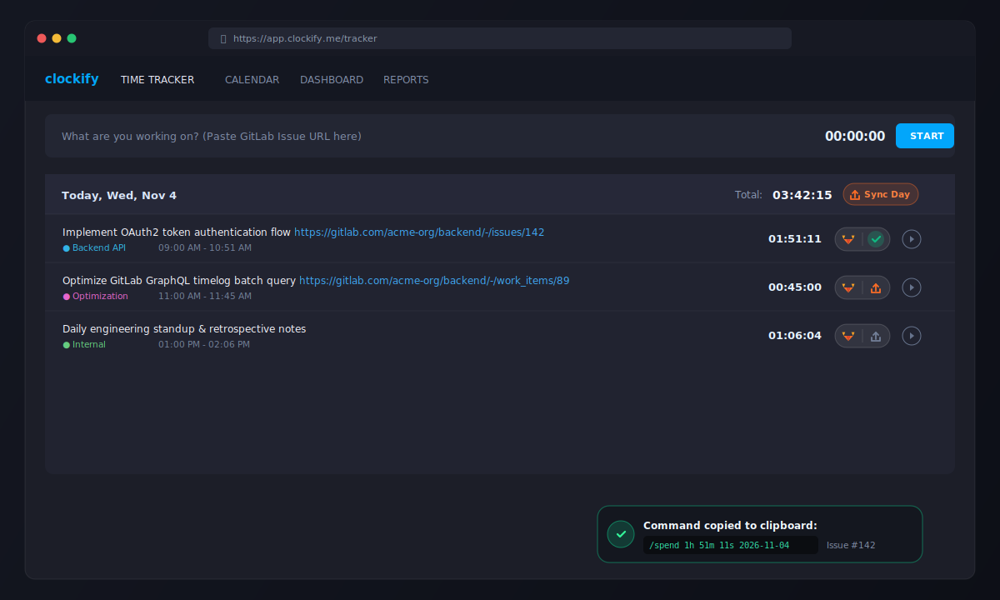
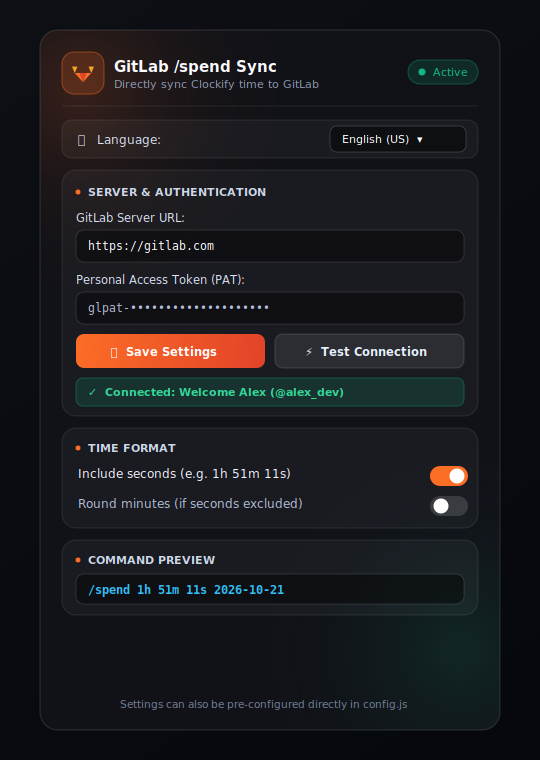

# Clockify to GitLab /spend Copier & Syncer

A lightweight Google Chrome extension that integrates **Clockify** time tracking with **GitLab Issues & Work Items**. It embeds clean action buttons directly into Clockify's web interface to copy `/spend` commands or sync time logs directly via GitLab's API with automatic duplicate detection.

---

## Preview

### Clockify Web App Integration


### Extension Settings
<p align="center">
  
</p>

---

## The Problem It Solves

When teams track daily work in Clockify but manage projects and sprints in GitLab, logging time is repetitive:
1. You finish a task and check the tracked duration in Clockify.
2. You open the corresponding GitLab issue or work item in a new tab.
3. You manually write `/spend 1h 45m 2026-11-04` into the comment box.

This extension streamlines that workflow right from the Clockify tracker table.

---

## Features

- **1-Click Direct Sync**: Syncs your time entry directly to the GitLab issue or work item referenced in the Clockify description using GitLab's API.
- **Bulk Day Sync ("Sync Day")**: A single button on each day header syncs all valid entries for that day in sequence, reporting counts for synced, duplicate, skipped, and failed items.
- **Duplicate Prevention**: Before sending any `/spend` command, the extension inspects existing GitLab GraphQL timelogs and issue system notes. If an entry for that date and duration already exists, it flags it with a warning icon to prevent double logging.
- **Copy `/spend` to Clipboard**: Click the GitLab icon on any entry row to copy the formatted command (e.g. `/spend 1h 30m 15s 2026-11-04`) to your clipboard.
- **Multi-Language with Dynamic RTL/LTR**: Built-in internationalization (i18n) supporting 10 languages with immediate direction switching:
  - English (`en` - LTR)
  - Deutsch (`de` - LTR)
  - Français (`fr` - LTR)
  - 简体中文 (`zh` - LTR)
  - العربية (`ar` - RTL)
  - فارسی (`fa` - RTL)
  - Русский (`ru` - LTR)
  - हिन्दी (`hi` - LTR)
  - Español (`es` - LTR)
  - Türkçe (`tr` - LTR)
- **Configurable Time Format**: Choose whether to include seconds (e.g. `1h 15m 30s` vs `1h 15m`) and whether to round minutes up when seconds are 30+.
- **Self-Hosted & GitLab.com**: Works with `gitlab.com` as well as private, self-hosted, or enterprise GitLab instances.
- **Glassmorphic UI**: Lightweight frosted-glass buttons styled to seamlessly adapt to both light and dark Clockify themes.

---

## How It Works

1. Add the GitLab issue or work item URL anywhere in your Clockify entry description:
   ```text
   Fix authentication bug https://gitlab.com/my-org/my-project/-/issues/42
   ```
   Or for GitLab Work Items:
   ```text
   Refactor user store https://gitlab.com/my-org/my-project/-/work_items/105
   ```
2. The extension automatically detects the issue link and enables the direct sync button.
3. Click the sync button on the row (or the **Sync Day** button in the day header) to log your time.

---

## Installation

You can install and run the extension directly in Google Chrome:

1. Clone or download this repository:
   ```bash
   git clone https://github.com/YOUR_USERNAME/clockify-to-gitlab.git
   ```
2. Open Google Chrome and go to:
   ```text
   chrome://extensions/
   ```
3. Enable **Developer mode** using the toggle switch in the top-right corner.
4. Click the **Load unpacked** button and select the repository folder.
5. Open or refresh [Clockify](https://app.clockify.me/tracker).

---

## Configuration

Click the extension icon in your Chrome toolbar to open the settings popup:

- **Language**: Choose your preferred language. The layout automatically switches direction (RTL or LTR).
- **GitLab Server URL**: Defaults to `https://gitlab.com`. Set this to your custom domain if using a self-hosted instance (e.g. `https://gitlab.yourcompany.com`).
- **Personal Access Token**: Create a token in GitLab under `User Settings` &rarr; `Access Tokens` &rarr; `Add new token` with the `api` scope.
- **Time Format**: Configure whether to include seconds and whether to round minutes.
- **Test Connection**: Verify your credentials and server reachability before syncing.

> Settings can also be predefined directly in `config.js` if you prefer setting defaults via code.

---

## Security & Privacy

- All credentials and preferences are stored exclusively in your browser via `chrome.storage.sync`.
- API calls are made directly from your browser to your configured GitLab instance.
- No third-party servers, tracking, analytics, or telemetry are used.

---

## License

This project is licensed under the MIT License. See [LICENSE](LICENSE) for details.
